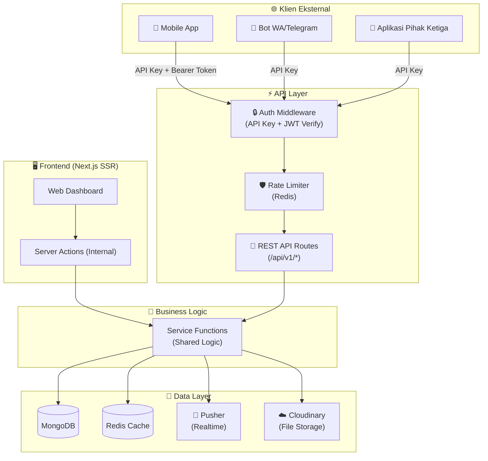
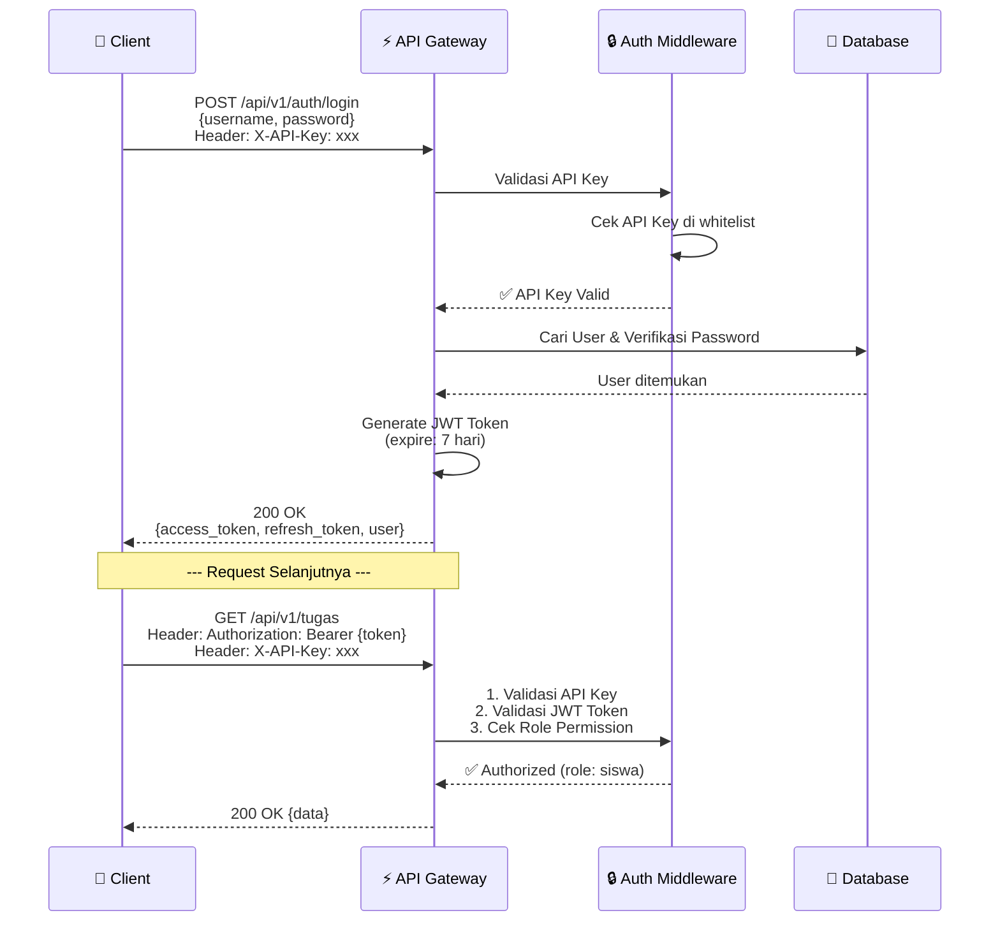

# 🏗️ Perencanaan Full REST API — TugasKu

> **Sistem Manajemen Akademik SMAN 1 Margaasih**  
> Versi: `2.0.0` | Stack: Next.js 16 + MongoDB (Mongoose) + NextAuth v5  
> Tanggal: 28 Oktober 2026

---

## 📌 Daftar Isi

1. [Ringkasan & Tujuan](#1-ringkasan--tujuan)
2. [Arsitektur API](#2-arsitektur-api)
3. [🔒 Desain Keamanan (Security)](#3--desain-keamanan-security)
4. [Struktur File & Folder](#4-struktur-file--folder)
5. [📡 Katalog Endpoint Lengkap](#5--katalog-endpoint-lengkap)
   - [A. Autentikasi](#a-autentikasi)
   - [B. Siswa (Members)](#b-siswa-members)
   - [C. Tugas](#c-tugas)
   - [D. Nilai & Pengumpulan](#d-nilai--pengumpulan)
   - [E. Absensi](#e-absensi)
   - [F. Pengumuman](#f-pengumuman)
   - [G. Materi Belajar](#g-materi-belajar)
   - [H. Diskusi Materi](#h-diskusi-materi)
   - [I. Kuis (Soal PG)](#i-kuis-soal-pg)
   - [J. Pengerjaan Kuis](#j-pengerjaan-kuis)
   - [K. Kelompok](#k-kelompok)
   - [L. Jadwal](#l-jadwal)
   - [M. Sistem & Admin](#m-sistem--admin)
6. [Skema Data (Schema Reference)](#6-skema-data-schema-reference)
7. [Format Response Standar](#7-format-response-standar)
8. [Kode Status HTTP](#8-kode-status-http)
9. [Rate Limiting & Throttling](#9-rate-limiting--throttling)
10. [Contoh Integrasi Klien](#10-contoh-integrasi-klien)
11. [Rencana Implementasi (Roadmap)](#11-rencana-implementasi-roadmap)

---

## 1. Ringkasan & Tujuan

Aplikasi **TugasKu** saat ini menggunakan **Server Actions** (Next.js) untuk logika bisnis, yang hanya bisa diakses dari frontend bawaan. Perencanaan ini bertujuan untuk **mengekspos seluruh fitur sebagai REST API** agar:

- ✅ Bisa dikonsumsi oleh **aplikasi mobile** (Flutter, React Native, Kotlin)
- ✅ Bisa dikonsumsi oleh **bot messaging** (WhatsApp, Telegram, Discord)
- ✅ Bisa digunakan oleh **aplikasi pihak ketiga** via integrasi
- ✅ Menjadi **single source of truth** yang terpusat dan terdokumentasi
- ✅ Memisahkan concern antara **backend API** dan **frontend UI**

---

## 2. Arsitektur API



> [!IMPORTANT]
> **Prinsip Utama**: Server Actions (untuk frontend Next.js) dan API Routes (untuk klien eksternal) akan **berbagi logic yang sama** melalui **Service Layer**, sehingga tidak ada duplikasi kode.

---

## 3. 🔒 Desain Keamanan (Security)

### 3.1 Mekanisme Autentikasi (3-Layer)



| Layer | Mekanisme | Tujuan |
|:------|:----------|:-------|
| **Layer 1** | `X-API-Key` Header | Identifikasi aplikasi klien (siapa yang mengakses) |
| **Layer 2** | `Authorization: Bearer {JWT}` | Identifikasi user yang login (siapa usernya) |
| **Layer 3** | Role-Based Access Control (RBAC) | Otorisasi aksi berdasarkan role (`admin`, `siswa`) |

### 3.2 API Key Management

```typescript
// Skema: ApiKey (MongoDB Collection baru)
{
  key: "tk_live_abc123...",     // Format: tk_{env}_{random_32_char}
  name: "Mobile App Android",   // Nama aplikasi klien
  owner: "admin@sekolah.com",   // Siapa yang mendaftarkan
  permissions: ["read", "write"], // Scope izin
  rate_limit: 100,               // Request per menit
  is_active: true,
  allowed_ips: ["*"],            // Whitelist IP (opsional)
  created_at: Date,
  last_used_at: Date,
  expires_at: Date               // Null = tidak expire
}
```

> [!TIP]
> **Format API Key**: `tk_live_` untuk produksi, `tk_test_` untuk development. Ini memudahkan identifikasi environment.

### 3.3 JWT Token Structure

```json
{
  "sub": "user_id_mongodb",
  "email": "user@siswa.com",
  "role": "siswa",
  "member_id": "member_id_mongodb",
  "nama": "John Doe",
  "kelas": "XI 1",
  "iat": 1698508800,
  "exp": 1699113600,
  "iss": "tugasku-api"
}
```

### 3.4 Security Headers & Proteksi

| Proteksi | Implementasi |
|:---------|:-------------|
| **CORS** | Whitelist origin berdasarkan API Key |
| **Rate Limiting** | Redis-based, per API Key (100 req/min default) |
| **Input Validation** | Zod schema validation pada setiap endpoint |
| **SQL/NoSQL Injection** | Mongoose sanitization + manual field check |
| **Brute Force Login** | Max 5 attempt/15 menit per IP, lockout 30 menit |
| **HTTPS Only** | Enforce HTTPS di production via middleware |
| **Request Size Limit** | Max 10MB untuk upload, 1MB untuk JSON body |
| **Helmet Headers** | `X-Content-Type-Options`, `X-Frame-Options`, `Strict-Transport-Security` |
| **Audit Trail** | Semua request dicatat ke `LogAktivitasSiswa` |

### 3.5 RBAC Permission Matrix

| Endpoint Group | `admin` | `siswa` | `public` (API Key only) |
|:---------------|:-------:|:-------:|:-----------------------:|
| Auth (login/register) | ✅ | ✅ | ✅ |
| Siswa CRUD | ✅ Full | 🔍 Self only | ❌ |
| Tugas | ✅ CRUD | 🔍 Read | ❌ |
| Nilai | ✅ CRUD | 🔍 Self only | ❌ |
| Absensi | ✅ CRUD | ✏️ Self create | ❌ |
| Pengumuman | ✅ CRUD | 🔍 Read | 🔍 Read |
| Materi | ✅ CRUD | 🔍 Read + Download | ❌ |
| Diskusi | ✅ Full + Delete | ✏️ Post + Read | ❌ |
| Kuis | ✅ CRUD | 🔍 Read + Submit | ❌ |
| Kelompok | ✅ CRUD | 🔍 Read own group | ❌ |
| Jadwal | ✅ Full | 🔍 Own kelas | 🔍 Read |
| System/Backup | ✅ Only | ❌ | ❌ |

---

## 4. Struktur File & Folder

```
app/api/v1/
├── _middleware/
│   ├── withApiKey.ts          # Validasi API Key
│   ├── withAuth.ts            # Validasi JWT + Session
│   ├── withRateLimit.ts       # Rate Limiting (Redis)
│   ├── withValidation.ts      # Zod Input Validation
│   └── withRBAC.ts            # Role-based access control
│
├── auth/
│   ├── login/route.ts         # POST   - Login (JWT issue)
│   ├── refresh/route.ts       # POST   - Refresh token
│   ├── logout/route.ts        # POST   - Invalidate token
│   ├── me/route.ts            # GET    - Profile user saat ini
│   └── change-password/route.ts # PUT  - Ubah password
│
├── siswa/
│   ├── route.ts               # GET (list) + POST (create)
│   ├── [id]/route.ts          # GET + PUT + DELETE
│   ├── import/route.ts        # POST   - Import Excel
│   ├── [id]/reset-password/route.ts  # POST - Reset password siswa
│   └── export/route.ts        # GET    - Export data siswa
│
├── tugas/
│   ├── route.ts               # GET (list) + POST (create)
│   ├── [id]/route.ts          # GET + PUT + DELETE
│   ├── [id]/toggle/route.ts   # PATCH  - Toggle status aktif
│   ├── import/route.ts        # POST   - Import Excel
│   └── kelompok/route.ts      # POST   - Buat tugas kelompok
│
├── nilai/
│   ├── route.ts               # GET (list berdasarkan filter)
│   ├── [id]/route.ts          # PUT + DELETE
│   ├── submit/route.ts        # POST   - Siswa submit nilai/file
│   ├── grade/route.ts         # POST   - Admin input nilai
│   └── import/route.ts        # POST   - Import nilai Excel
│
├── absensi/
│   ├── route.ts               # GET (list/rekap)
│   ├── check-in/route.ts      # POST   - Siswa absen masuk
│   ├── upsert/route.ts        # PUT    - Admin ubah absensi
│   └── export/route.ts        # GET    - Export absensi
│
├── pengumuman/
│   ├── route.ts               # GET (list) + POST (create)
│   └── [id]/route.ts          # GET + DELETE
│
├── materi/
│   ├── route.ts               # GET (list) + POST (create)
│   ├── [id]/route.ts          # GET + PUT + DELETE
│   ├── [id]/download/route.ts # POST   - Track download
│   └── [id]/log/route.ts      # GET    - Log unduhan
│
├── diskusi/
│   ├── [materiId]/route.ts    # GET (list komentar)
│   ├── [materiId]/post/route.ts # POST - Kirim komentar
│   ├── [commentId]/route.ts   # DELETE - Hapus komentar
│   └── [materiId]/clear/route.ts # DELETE - Clear diskusi
│
├── kuis/
│   ├── route.ts               # GET (list) + POST (create)
│   ├── [id]/route.ts          # GET + PUT + DELETE
│   ├── [id]/toggle/route.ts   # PATCH  - Toggle status kuis
│   ├── [id]/submit/route.ts   # POST   - Submit jawaban kuis
│   ├── [id]/autosave/route.ts # POST   - Auto-save jawaban
│   ├── [id]/result/route.ts   # GET    - Hasil pengerjaan
│   └── export/route.ts        # GET    - Export hasil kuis
│
├── kelompok/
│   ├── route.ts               # GET (list) + POST (create)
│   ├── [id]/route.ts          # GET + DELETE
│   ├── move/route.ts          # PUT    - Pindah anggota
│   └── [id]/ketua/route.ts    # PUT    - Ubah ketua
│
├── jadwal/
│   ├── route.ts               # GET    - Semua jadwal
│   ├── kelas/[kelas]/route.ts # GET    - Jadwal per kelas
│   ├── hari/[hari]/route.ts   # GET    - Jadwal per hari
│   ├── guru/[nama]/route.ts   # GET    - Jadwal per guru
│   └── guru-list/route.ts     # GET    - Daftar semua guru
│
├── system/
│   ├── health/route.ts        # GET    - Health check
│   ├── stats/route.ts         # GET    - Statistik dashboard
│   ├── backup/route.ts        # GET    - Download backup
│   ├── restore/route.ts       # POST   - Restore backup
│   ├── reset/route.ts         # DELETE - Reset database
│   ├── logs/route.ts          # GET    - Activity logs
│   ├── api-keys/route.ts      # GET + POST - Manage API keys
│   ├── api-keys/[id]/route.ts # PUT + DELETE - Edit/revoke key
│   └── settings/
│       └── ai-model/route.ts  # GET + PUT - AI Model settings
│
├── upload/
│   └── route.ts               # POST   - Generic file upload
│
└── docs/
    └── openapi.json           # OpenAPI 3.1 spec (auto-generated)
```

---

## 5. 📡 Katalog Endpoint Lengkap

### A. Autentikasi

---

#### `POST /api/v1/auth/login`

Login dan mendapatkan JWT token.

| Property | Value |
|:---------|:------|
| **Auth** | API Key only (no JWT needed) |
| **Role** | Public |

**Request Body:**
```json
{
  "username": "2201001@siswa.com",
  "password": "123456"
}
```

**Response `200 OK`:**
```json
{
  "success": true,
  "message": "Login berhasil",
  "data": {
    "access_token": "eyJhbGciOiJIUzI1NiIsInR5cCI6...",
    "refresh_token": "eyJhbGciOiJIUzI1NiIsInR5cCI6...",
    "token_type": "Bearer",
    "expires_in": 604800,
    "user": {
      "id": "6654abc123def",
      "nama": "Ahmad Fauzi",
      "email": "2201001@siswa.com",
      "role": "siswa",
      "kelas": "XI 1"
    }
  }
}
```

**Response `401 Unauthorized`:**
```json
{
  "success": false,
  "error": {
    "code": "INVALID_CREDENTIALS",
    "message": "Username atau password salah"
  }
}
```

**Response `429 Too Many Requests`:**
```json
{
  "success": false,
  "error": {
    "code": "RATE_LIMIT_EXCEEDED",
    "message": "Terlalu banyak percobaan login. Coba lagi dalam 15 menit.",
    "retry_after": 900
  }
}
```

---

#### `POST /api/v1/auth/refresh`

Perbarui access token yang sudah expired menggunakan refresh token.

| Property | Value |
|:---------|:------|
| **Auth** | API Key only |
| **Role** | Public |

**Request Body:**
```json
{
  "refresh_token": "eyJhbGciOiJIUzI1NiIsInR5cCI6..."
}
```

**Response `200 OK`:**
```json
{
  "success": true,
  "data": {
    "access_token": "new_eyJhbGciOiJIUzI1NiIs...",
    "expires_in": 604800
  }
}
```

---

#### `GET /api/v1/auth/me`

Ambil profil user yang sedang login.

| Property | Value |
|:---------|:------|
| **Auth** | API Key + JWT Bearer |
| **Role** | `admin`, `siswa` |

**Response `200 OK`:**
```json
{
  "success": true,
  "data": {
    "id": "6654abc123def",
    "nama": "Ahmad Fauzi",
    "email": "2201001@siswa.com",
    "role": "siswa",
    "member": {
      "nis": "2201001",
      "nama_lengkap": "Ahmad Fauzi",
      "kelas": "XI 1",
      "jenis_kelamin": "L",
      "poin_keaktifan": 35
    }
  }
}
```

---

#### `PUT /api/v1/auth/change-password`

Ubah password user yang sedang login.

| Property | Value |
|:---------|:------|
| **Auth** | API Key + JWT Bearer |
| **Role** | `admin`, `siswa` |

**Request Body:**
```json
{
  "old_password": "123456",
  "new_password": "rahasiaBaruKu",
  "confirm_password": "rahasiaBaruKu"
}
```

---

### B. Siswa (Members)

---

#### `GET /api/v1/siswa`

Daftar seluruh siswa. Mendukung filter, pagination, dan search.

| Property | Value |
|:---------|:------|
| **Auth** | API Key + JWT Bearer |
| **Role** | `admin` |

**Query Parameters:**

| Param | Type | Default | Description |
|:------|:-----|:--------|:------------|
| `page` | integer | `1` | Halaman |
| `limit` | integer | `20` | Jumlah per halaman (max 100) |
| `kelas` | string | — | Filter kelas (e.g. `XI 1`) |
| `search` | string | — | Cari berdasarkan NIS / Nama |
| `jenis_kelamin` | string | — | Filter: `L` / `P` |
| `sort` | string | `nama_lengkap` | Field sorting |
| `order` | string | `asc` | `asc` / `desc` |

**Response `200 OK`:**
```json
{
  "success": true,
  "data": [
    {
      "id": "6654abc123def",
      "nis": "2201001",
      "nama_lengkap": "Ahmad Fauzi",
      "kelas": "XI 1",
      "jenis_kelamin": "L",
      "poin_keaktifan": 35
    }
  ],
  "pagination": {
    "page": 1,
    "limit": 20,
    "total": 345,
    "total_pages": 18
  }
}
```

---

#### `POST /api/v1/siswa`

Tambah siswa baru (otomatis membuat akun login).

| Property | Value |
|:---------|:------|
| **Auth** | API Key + JWT Bearer |
| **Role** | `admin` |

**Request Body:**
```json
{
  "nis": "2201099",
  "nama_lengkap": "Siti Nurhaliza",
  "kelas": "XII 3",
  "jenis_kelamin": "P"
}
```

**Response `201 Created`:**
```json
{
  "success": true,
  "message": "Siswa berhasil ditambahkan",
  "data": {
    "id": "6654abc123ghi",
    "nis": "2201099",
    "nama_lengkap": "Siti Nurhaliza",
    "kelas": "XII 3",
    "jenis_kelamin": "P",
    "poin_keaktifan": 0,
    "akun_login": {
      "email": "2201099@siswa.com",
      "default_password": "123456"
    }
  }
}
```

---

#### `GET /api/v1/siswa/:id`

Detail satu siswa beserta ringkasan akademik.

| Property | Value |
|:---------|:------|
| **Auth** | API Key + JWT Bearer |
| **Role** | `admin` (full) / `siswa` (self only) |

---

#### `PUT /api/v1/siswa/:id`

Update data siswa.

| Property | Value |
|:---------|:------|
| **Auth** | API Key + JWT Bearer |
| **Role** | `admin` |

**Request Body:**
```json
{
  "nama_lengkap": "Ahmad Fauzi (Updated)",
  "nis": "2201001",
  "kelas": "XII 1",
  "jenis_kelamin": "L"
}
```

---

#### `DELETE /api/v1/siswa/:id`

Hapus siswa (cascade: hapus user login + nilai terkait).

| Property | Value |
|:---------|:------|
| **Auth** | API Key + JWT Bearer |
| **Role** | `admin` |

---

#### `POST /api/v1/siswa/import`

Import batch siswa via file Excel.

| Property | Value |
|:---------|:------|
| **Auth** | API Key + JWT Bearer |
| **Role** | `admin` |
| **Content-Type** | `multipart/form-data` |

**Form Fields:**
- `file` — File Excel (.xlsx)

**Format Kolom Excel:** `NIS | Nama | Kelas | Jenis Kelamin | Email | Password`

---

#### `POST /api/v1/siswa/:id/reset-password`

Reset password siswa ke default (`123456`).

| Property | Value |
|:---------|:------|
| **Auth** | API Key + JWT Bearer |
| **Role** | `admin` |

---

#### `POST /api/v1/siswa/:id/poin`

Tambah poin keaktifan siswa.

| Property | Value |
|:---------|:------|
| **Auth** | API Key + JWT Bearer |
| **Role** | `admin` |

**Request Body:**
```json
{
  "points": 5
}
```

---

### C. Tugas

---

#### `GET /api/v1/tugas`

Daftar semua tugas. Mendukung filter berdasarkan kelas, tipe, dan status.

| Property | Value |
|:---------|:------|
| **Auth** | API Key + JWT Bearer |
| **Role** | `admin` (semua), `siswa` (tugas kelasnya) |

**Query Parameters:**

| Param | Type | Default | Description |
|:------|:-----|:--------|:------------|
| `page` | integer | `1` | Halaman |
| `limit` | integer | `20` | Jumlah per halaman |
| `kelas` | string | — | Filter kelas |
| `tipe_tugas` | string | — | `individu` / `kelompok` |
| `tipe_pengumpulan` | string | — | `online` / `offline` |
| `is_active` | boolean | — | Filter status aktif |
| `sort` | string | `dibuat_pada` | Field sorting |
| `order` | string | `desc` | `asc` / `desc` |

**Response `200 OK`:**
```json
{
  "success": true,
  "data": [
    {
      "id": "6654tugas001",
      "judul": "Laporan Praktikum Fisika",
      "deskripsi": "Buat laporan percobaan gerak lurus beraturan",
      "deadline": "2026-11-15T23:59:59.000Z",
      "kelas": ["XI 1", "XI 2"],
      "is_active": true,
      "tipe_pengumpulan": "online",
      "tipe_tugas": "individu",
      "dibuat_pada": "2026-10-20T08:00:00.000Z",
      "stats": {
        "total_siswa": 72,
        "sudah_mengumpulkan": 45,
        "belum_mengumpulkan": 27
      }
    }
  ],
  "pagination": { "page": 1, "limit": 20, "total": 12, "total_pages": 1 }
}
```

---

#### `POST /api/v1/tugas`

Buat tugas baru.

| Property | Value |
|:---------|:------|
| **Auth** | API Key + JWT Bearer |
| **Role** | `admin` |

**Request Body:**
```json
{
  "judul": "Essay Sejarah Indonesia",
  "deskripsi": "Tulis essay tentang perjuangan kemerdekaan.",
  "deadline": "2026-11-20T23:59:59.000Z",
  "kelas": ["XII 1", "XII 2", "XII 3"],
  "tipe_pengumpulan": "online",
  "tipe_tugas": "individu"
}
```

---

#### `GET /api/v1/tugas/:id`

Detail tugas beserta statistik pengumpulan.

---

#### `PUT /api/v1/tugas/:id`

Update tugas. Mendukung partial update (hanya field yang dikirim).

---

#### `DELETE /api/v1/tugas/:id`

Hapus tugas (cascade: hapus semua nilai terkait).

---

#### `PATCH /api/v1/tugas/:id/toggle`

Toggle status aktif/nonaktif tugas (buka/tutup pengumpulan).

| Property | Value |
|:---------|:------|
| **Auth** | API Key + JWT Bearer |
| **Role** | `admin` |

**Response `200 OK`:**
```json
{
  "success": true,
  "message": "Status tugas berhasil diubah",
  "data": {
    "id": "6654tugas001",
    "is_active": false
  }
}
```

---

#### `POST /api/v1/tugas/import`

Import tugas dari file Excel.

| Property | Value |
|:---------|:------|
| **Auth** | API Key + JWT Bearer |
| **Role** | `admin` |
| **Content-Type** | `multipart/form-data` |

**Format Kolom Excel:** `Judul | Deskripsi | Deadline | Kelas`

---

#### `POST /api/v1/tugas/kelompok`

Buat tugas kelompok (dengan auto-generate kelompok + inisialisasi nilai).

| Property | Value |
|:---------|:------|
| **Auth** | API Key + JWT Bearer |
| **Role** | `admin` |

**Request Body:**
```json
{
  "judul": "Presentasi Kelompok Biologi",
  "deskripsi": "Kelompok mempresentasikan topik ekosistem",
  "deadline": "2026-11-25T23:59:59.000Z",
  "kelas": "XI 1",
  "tipe_pengumpulan": "online",
  "kelompok_data": [
    {
      "nama": "Kelompok 1",
      "ketua": "member_id_001",
      "anggota": ["member_id_001", "member_id_002", "member_id_003"]
    },
    {
      "nama": "Kelompok 2",
      "ketua": "member_id_004",
      "anggota": ["member_id_004", "member_id_005", "member_id_006"]
    }
  ]
}
```

---

### D. Nilai & Pengumpulan

---

#### `GET /api/v1/nilai`

Daftar nilai berdasarkan filter.

| Property | Value |
|:---------|:------|
| **Auth** | API Key + JWT Bearer |
| **Role** | `admin` (semua), `siswa` (self only) |

**Query Parameters:**

| Param | Type | Description |
|:------|:-----|:------------|
| `member_id` | string | Filter by siswa |
| `tugas_id` | string | Filter by tugas |
| `kelas` | string | Filter by kelas |
| `page` | integer | Halaman |
| `limit` | integer | Jumlah per halaman |

**Response `200 OK`:**
```json
{
  "success": true,
  "data": [
    {
      "id": "6654nilai001",
      "member": {
        "id": "6654abc123",
        "nama": "Ahmad Fauzi",
        "nis": "2201001",
        "kelas": "XI 1"
      },
      "tugas": {
        "id": "6654tugas001",
        "judul": "Laporan Praktikum Fisika"
      },
      "nilai": 85.5,
      "file_url": "/api/uploads/laporan_praktikum/Ahmad_Fauzi_2201001.webp",
      "catatan_siswa": "Sudah selesai pak",
      "tanggal_mengumpulkan": "2026-11-10T14:30:00.000Z",
      "tanggal_dinilai": "2026-11-12T09:00:00.000Z"
    }
  ],
  "pagination": { "page": 1, "limit": 20, "total": 45, "total_pages": 3 }
}
```

---

#### `POST /api/v1/nilai/submit`

Siswa mengirim/mengumpulkan tugas (upload file).

| Property | Value |
|:---------|:------|
| **Auth** | API Key + JWT Bearer |
| **Role** | `siswa` |
| **Content-Type** | `multipart/form-data` |

**Form Fields:**
- `tugas_id` — ID tugas (required)
- `file` — File tugas (required)
- `catatan` — Catatan opsional

**Logika Khusus:**
- Jika tugas `tipe_tugas: 'kelompok'`, **hanya ketua** yang bisa submit
- File image otomatis dikonversi ke WebP
- File disimpan ke folder: `/public/uploads/{judul_tugas}/{nama_nis}.ext`
- Jika kelompok, nilai di-forward ke semua anggota

---

#### `POST /api/v1/nilai/grade`

Admin memberikan nilai ke siswa.

| Property | Value |
|:---------|:------|
| **Auth** | API Key + JWT Bearer |
| **Role** | `admin` |

**Request Body:**
```json
{
  "member_id": "6654abc123",
  "tugas_id": "6654tugas001",
  "nilai": 87.5
}
```

**Logika Khusus:**
- Jika tugas kelompok dan yang dinilai adalah ketua, **semua anggota kelompok otomatis mendapat nilai yang sama**

---

#### `POST /api/v1/nilai/import`

Import nilai dari file Excel (untuk tugas offline).

| Property | Value |
|:---------|:------|
| **Auth** | API Key + JWT Bearer |
| **Role** | `admin` |

**Form Fields:**
- `tugas_id` — ID tugas
- `file` — File Excel (.xlsx)

**Format Kolom Excel:** `NIS | Nama | Nilai`

---

#### `DELETE /api/v1/nilai/:id`

Hapus record nilai spesifik.

---

### E. Absensi

---

#### `GET /api/v1/absensi`

Rekap absensi. Mendukung filter tanggal, kelas, dan siswa.

| Property | Value |
|:---------|:------|
| **Auth** | API Key + JWT Bearer |
| **Role** | `admin` |

**Query Parameters:**

| Param | Type | Description |
|:------|:-----|:------------|
| `kelas` | string | Filter kelas |
| `member_id` | string | Filter siswa spesifik |
| `tanggal_mulai` | string (ISO date) | Filter dari tanggal |
| `tanggal_selesai` | string (ISO date) | Filter sampai tanggal |
| `status` | string | `Hadir` / `Izin` / `Sakit` |

---

#### `POST /api/v1/absensi/check-in`

Siswa melakukan absensi harian. Hanya bisa 1x per hari.

| Property | Value |
|:---------|:------|
| **Auth** | API Key + JWT Bearer |
| **Role** | `siswa` |

**Response `200 OK`:**
```json
{
  "success": true,
  "message": "Berhasil Absen Masuk!",
  "data": {
    "tanggal": "2026-10-28",
    "waktu": "2026-10-28T07:15:00.000Z",
    "status": "Hadir"
  }
}
```

**Response `409 Conflict`:**
```json
{
  "success": false,
  "error": {
    "code": "ALREADY_CHECKED_IN",
    "message": "Anda sudah mengisi absensi hari ini."
  }
}
```

---

#### `PUT /api/v1/absensi/upsert`

Admin mengubah/menambah status absensi siswa.

| Property | Value |
|:---------|:------|
| **Auth** | API Key + JWT Bearer |
| **Role** | `admin` |

**Request Body:**
```json
{
  "member_id": "6654abc123",
  "tanggal": "2026-10-28",
  "status": "Izin"
}
```

---

### F. Pengumuman

---

#### `GET /api/v1/pengumuman`

Daftar pengumuman. Mendukung filter prioritas.

| Property | Value |
|:---------|:------|
| **Auth** | API Key + JWT Bearer / API Key only |
| **Role** | `admin`, `siswa`, `public` |

**Query Parameters:**

| Param | Type | Description |
|:------|:-----|:------------|
| `prioritas` | string | `Penting` / `Info` / `Libur` |
| `page` | integer | Halaman |
| `limit` | integer | Jumlah per halaman |

---

#### `POST /api/v1/pengumuman`

Buat pengumuman baru (otomatis broadcast via Pusher).

| Property | Value |
|:---------|:------|
| **Auth** | API Key + JWT Bearer |
| **Role** | `admin` |

**Request Body:**
```json
{
  "judul": "Libur Hari Guru",
  "konten": "Sekolah diliburkan tanggal 25 November dalam rangka Hari Guru Nasional.",
  "prioritas": "Libur"
}
```

---

#### `DELETE /api/v1/pengumuman/:id`

Hapus pengumuman.

---

### G. Materi Belajar

---

#### `GET /api/v1/materi`

Daftar materi belajar.

| Property | Value |
|:---------|:------|
| **Auth** | API Key + JWT Bearer |
| **Role** | `admin`, `siswa` |

**Query Parameters:**

| Param | Type | Description |
|:------|:-----|:------------|
| `kelas` | string | Filter kelas |

---

#### `POST /api/v1/materi`

Upload materi baru (broadcast via Pusher).

| Property | Value |
|:---------|:------|
| **Auth** | API Key + JWT Bearer |
| **Role** | `admin` |

**Request Body:**
```json
{
  "judul": "Rangkuman Bab 5 — Termodinamika",
  "deskripsi": "Materi ringkasan persiapan UAS",
  "file_url": "https://res.cloudinary.com/xxx/raw/upload/v123/materi/bab5.pdf",
  "kelas": ["XI 1", "XI 2"]
}
```

---

#### `POST /api/v1/materi/:id/download`

Catat log download materi (broadcast realtime via Pusher).

| Property | Value |
|:---------|:------|
| **Auth** | API Key + JWT Bearer |
| **Role** | `siswa` |

---

#### `GET /api/v1/materi/:id/log`

Ambil log siapa saja yang sudah download materi.

| Property | Value |
|:---------|:------|
| **Auth** | API Key + JWT Bearer |
| **Role** | `admin` |

---

### H. Diskusi Materi

---

#### `GET /api/v1/diskusi/:materiId`

Ambil komentar diskusi pada materi tertentu.

| Property | Value |
|:---------|:------|
| **Auth** | API Key + JWT Bearer |
| **Role** | `admin` (semua komentar), `siswa` (komentar admin + kelasnya saja) |

**Query Parameters:**
| Param | Type | Description |
|:------|:-----|:------------|
| `kelas` | string | Filter kelas (opsional, auto-detect dari token siswa) |

---

#### `POST /api/v1/diskusi/:materiId`

Kirim komentar diskusi.

| Property | Value |
|:---------|:------|
| **Auth** | API Key + JWT Bearer |
| **Role** | `admin`, `siswa` |

**Request Body:**
```json
{
  "komentar": "Pak, halaman 12 yang soal no. 3 itu jawaban A atau B?"
}
```

---

#### `DELETE /api/v1/diskusi/comment/:commentId`

Hapus satu komentar.

| Property | Value |
|:---------|:------|
| **Auth** | API Key + JWT Bearer |
| **Role** | `admin` |

---

#### `DELETE /api/v1/diskusi/:materiId/clear`

Bersihkan seluruh diskusi pada materi.

| Property | Value |
|:---------|:------|
| **Auth** | API Key + JWT Bearer |
| **Role** | `admin` |

**Query Parameters:**
| Param | Type | Description |
|:------|:-----|:------------|
| `kelas` | string | Opsional, hanya hapus komentar kelas tertentu |

---

### I. Kuis (Soal PG)

---

#### `GET /api/v1/kuis`

Daftar semua kuis/soal PG.

| Property | Value |
|:---------|:------|
| **Auth** | API Key + JWT Bearer |
| **Role** | `admin` (full + jawaban), `siswa` (tanpa jawaban_benar) |

**Query Parameters:**
| Param | Type | Description |
|:------|:-----|:------------|
| `kelas` | string | Filter kelas |
| `status` | string | `OPEN` / `CLOSED` / `AUTO` |

> [!WARNING]
> Untuk role `siswa`, field `jawaban_benar` pada `daftar_soal` **TIDAK** disertakan dalam response. Jawaban hanya muncul untuk role `admin`.

---

#### `POST /api/v1/kuis`

Buat kuis baru.

| Property | Value |
|:---------|:------|
| **Auth** | API Key + JWT Bearer |
| **Role** | `admin` |

**Request Body:**
```json
{
  "judul": "Kuis Matematika Bab 3",
  "deskripsi": "Materi Trigonometri",
  "kelas": ["XI 1", "XI 2"],
  "durasi": 45,
  "waktu_mulai": "2026-11-01T08:00:00.000Z",
  "waktu_selesai": "2026-11-01T09:00:00.000Z",
  "daftar_soal": [
    {
      "id": "soal_1",
      "pertanyaan": "Nilai sin 30° adalah...",
      "opsi": {
        "A": "0",
        "B": "0.5",
        "C": "1",
        "D": "√2/2",
        "E": "√3/2"
      },
      "jawaban_benar": "B",
      "gambar_url": null
    }
  ]
}
```

---

#### `GET /api/v1/kuis/:id`

Detail kuis beserta soal.

---

#### `PUT /api/v1/kuis/:id`

Update kuis (judul, soal, waktu, durasi).

---

#### `DELETE /api/v1/kuis/:id`

Hapus kuis dan seluruh pengerjaan terkait.

---

#### `PATCH /api/v1/kuis/:id/toggle`

Toggle status kuis (OPEN/CLOSED/AUTO).

---

### J. Pengerjaan Kuis

---

#### `POST /api/v1/kuis/:id/autosave`

Auto-save progress pengerjaan siswa.

| Property | Value |
|:---------|:------|
| **Auth** | API Key + JWT Bearer |
| **Role** | `siswa` |

**Request Body:**
```json
{
  "jawaban": {
    "soal_1": "B",
    "soal_2": "D",
    "soal_3": null
  }
}
```

---

#### `POST /api/v1/kuis/:id/submit`

Submit final jawaban kuis. Otomatis menghitung nilai.

| Property | Value |
|:---------|:------|
| **Auth** | API Key + JWT Bearer |
| **Role** | `siswa` |

**Request Body:**
```json
{
  "jawaban": {
    "soal_1": "B",
    "soal_2": "D",
    "soal_3": "A"
  }
}
```

**Response `200 OK`:**
```json
{
  "success": true,
  "message": "Kuis berhasil disubmit!",
  "data": {
    "nilai": 80,
    "benar": 8,
    "salah": 2,
    "total_soal": 10,
    "waktu_selesai": "2026-11-01T08:42:15.000Z"
  }
}
```

---

#### `GET /api/v1/kuis/:id/result`

Ambil hasil pengerjaan kuis.

| Property | Value |
|:---------|:------|
| **Auth** | API Key + JWT Bearer |
| **Role** | `admin` (semua siswa), `siswa` (self only) |

**Query Parameters (admin):**
| Param | Type | Description |
|:------|:-----|:------------|
| `kelas` | string | Filter kelas |
| `member_id` | string | Filter siswa spesifik |

---

### K. Kelompok

---

#### `GET /api/v1/kelompok`

Daftar kelompok berdasarkan kelas/tugas.

| Property | Value |
|:---------|:------|
| **Auth** | API Key + JWT Bearer |
| **Role** | `admin`, `siswa` (own group only) |

**Query Parameters:**
| Param | Type | Description |
|:------|:-----|:------------|
| `kelas` | string | Filter kelas |
| `tugas_id` | string | Filter tugas |

---

#### `POST /api/v1/kelompok`

Generate/simpan kelompok baru.

| Property | Value |
|:---------|:------|
| **Auth** | API Key + JWT Bearer |
| **Role** | `admin` |

---

#### `PUT /api/v1/kelompok/move`

Pindah anggota dari satu kelompok ke kelompok lain.

| Property | Value |
|:---------|:------|
| **Auth** | API Key + JWT Bearer |
| **Role** | `admin` |

**Request Body:**
```json
{
  "member_id": "6654abc123",
  "from_group_id": "group001",
  "to_group_id": "group002"
}
```

---

#### `PUT /api/v1/kelompok/:id/ketua`

Ubah ketua kelompok.

| Property | Value |
|:---------|:------|
| **Auth** | API Key + JWT Bearer |
| **Role** | `admin` |

**Request Body:**
```json
{
  "member_id": "6654abc456"
}
```

---

### L. Jadwal

---

#### `GET /api/v1/jadwal`

Semua data jadwal pelajaran.

| Property | Value |
|:---------|:------|
| **Auth** | API Key + JWT Bearer |
| **Role** | `admin`, `siswa` |

---

#### `GET /api/v1/jadwal/kelas/:kelas`

Jadwal per kelas (e.g. `/api/v1/jadwal/kelas/X-1`).

---

#### `GET /api/v1/jadwal/hari/:hari`

Jadwal per hari (e.g. `/api/v1/jadwal/hari/senin`).

---

#### `GET /api/v1/jadwal/guru/:nama`

Cari jadwal mengajar guru berdasarkan nama (substring, case-insensitive).

---

#### `GET /api/v1/jadwal/guru-list`

Daftar semua guru beserta kode dan mapel.

---

### M. Sistem & Admin

---

#### `GET /api/v1/system/health`

Health check endpoint (bisa tanpa autentikasi).

| Property | Value |
|:---------|:------|
| **Auth** | None |
| **Role** | Public |

**Response `200 OK`:**
```json
{
  "status": "healthy",
  "version": "2.0.0",
  "uptime": 86400,
  "database": "connected",
  "redis": "connected",
  "timestamp": "2026-10-28T22:00:00.000Z"
}
```

---

#### `GET /api/v1/system/stats`

Statistik dashboard (jumlah siswa, tugas, dsb).

| Property | Value |
|:---------|:------|
| **Auth** | API Key + JWT Bearer |
| **Role** | `admin` |

---

#### `GET /api/v1/system/backup`

Download backup database (encrypted).

| Property | Value |
|:---------|:------|
| **Auth** | API Key + JWT Bearer |
| **Role** | `admin` |

---

#### `POST /api/v1/system/restore`

Restore database dari file backup.

| Property | Value |
|:---------|:------|
| **Auth** | API Key + JWT Bearer |
| **Role** | `admin` |

---

#### `DELETE /api/v1/system/reset`

Reset seluruh database (kecuali akun admin).

| Property | Value |
|:---------|:------|
| **Auth** | API Key + JWT Bearer |
| **Role** | `admin` |

> [!CAUTION]
> Endpoint ini akan **menghapus seluruh data siswa, tugas, nilai, dan absensi** secara permanen. Membutuhkan konfirmasi tambahan berupa field `confirm: "RESET_DATABASE"` di body request.

---

#### `GET /api/v1/system/logs`

Activity logs (LogAktivitasSiswa).

**Query Parameters:**
| Param | Type | Description |
|:------|:-----|:------------|
| `kategori` | string | `Siswa` / `Sistem` / `Console` / `Client` |
| `tipe` | string | `success` / `warning` / `error` |
| `limit` | integer | Jumlah log (max 500) |

---

#### `GET /api/v1/system/api-keys` + `POST`

Kelola API keys (list, create).

---

#### `PUT /api/v1/system/api-keys/:id` + `DELETE`

Edit/revoke API key spesifik.

---

#### `GET /api/v1/system/settings/ai-model`

Ambil pengaturan model AI.

---

#### `PUT /api/v1/system/settings/ai-model`

Update pengaturan model AI.

**Request Body:**
```json
{
  "ai_text_model": "groq/compound",
  "ai_vision_model": "llama-3.2-11b-vision-preview"
}
```

---

#### `POST /api/v1/upload`

Upload file generik (Cloudinary / lokal).

| Property | Value |
|:---------|:------|
| **Auth** | API Key + JWT Bearer |
| **Role** | `admin`, `siswa` |
| **Content-Type** | `multipart/form-data` |
| **Max Size** | 10MB |

---

## 6. Skema Data (Schema Reference)

| Model | Collection | Fields |
|:------|:-----------|:-------|
| **Member** | `members` | `nis`, `nama_lengkap`, `kelas`, `jenis_kelamin`, `poin_keaktifan` |
| **User** | `users` | `user` (email), `password` (MD5), `role`, `member_id` (ref) |
| **Tugas** | `tugas` | `judul`, `deskripsi`, `deadline`, `kelas`, `is_active`, `tipe_pengumpulan`, `tipe_tugas`, `dibuat_pada` |
| **Nilai** | `nilais` | `member_id`, `tugas_id`, `nilai`, `file_url`, `catatan_siswa`, `tanggal_mengumpulkan`, `tanggal_dinilai` |
| **Absensi** | `absensis` | `member_id`, `tanggal`, `waktu`, `status` |
| **Pengumuman** | `pengumumans` | `judul`, `konten`, `prioritas`, `dibuat_oleh`, `tanggal` |
| **Materi** | `materis` | `judul`, `deskripsi`, `file_url`, `kelas`, `diunggah_oleh`, `tanggal_upload`, `downloads[]` |
| **MateriComment** | `matericomments` | `materi_id`, `user_email`, `nama_pengirim`, `role_pengirim`, `kelas_siswa`, `komentar`, `dibuat_pada` |
| **SoalPG** | `soalpgs` | `judul`, `deskripsi`, `kelas`, `daftar_soal[]`, `dibuat_oleh`, `waktu_mulai`, `waktu_selesai`, `durasi`, `status_manual` |
| **PengerjaanKuis** | `pengerjaankuis` | `kuis_id`, `member_id`, `jawaban`, `status`, `nilai`, `benar`, `salah`, `mulai_mengerjakan`, `selesai_mengerjakan` |
| **Kelompok** | `kelompoks` | `tugas_id`, `nama_kelompok`, `kelas`, `ketua`, `anggota[]` |
| **LogTugas** | `logtugas` | `admin_email`, `tugas_judul`, `aksi`, `perubahan`, `waktu` |
| **LogKuis** | `logkuis` | `admin_email`, `kuis_judul`, `aksi`, `keterangan`, `waktu` |
| **LogAktivitasSiswa** | `logaktivitassiswas` | `nama_siswa`, `kelas`, `kategori`, `aksi`, `tipe`, `waktu` |
| **SystemSetting** | `systemsettings` | `key`, `value`, `updated_at` |
| **ApiKey** *(baru)* | `apikeys` | `key`, `name`, `owner`, `permissions`, `rate_limit`, `is_active`, `allowed_ips`, `created_at`, `last_used_at`, `expires_at` |

---

## 7. Format Response Standar

### Success Response

```json
{
  "success": true,
  "message": "Operasi berhasil",
  "data": { ... },
  "pagination": {
    "page": 1,
    "limit": 20,
    "total": 100,
    "total_pages": 5
  }
}
```

### Error Response

```json
{
  "success": false,
  "error": {
    "code": "VALIDATION_ERROR",
    "message": "Judul wajib diisi",
    "details": [
      {
        "field": "judul",
        "message": "Wajib diisi (required)",
        "received": null
      }
    ]
  }
}
```

### Error Codes

| Code | Description |
|:-----|:------------|
| `INVALID_API_KEY` | API Key tidak valid atau sudah dicabut |
| `INVALID_CREDENTIALS` | Username atau password salah |
| `TOKEN_EXPIRED` | JWT token sudah kadaluarsa |
| `TOKEN_INVALID` | JWT token tidak valid |
| `UNAUTHORIZED` | Belum login (tidak ada token) |
| `FORBIDDEN` | Role tidak punya akses ke endpoint ini |
| `VALIDATION_ERROR` | Input request tidak valid |
| `NOT_FOUND` | Resource tidak ditemukan |
| `ALREADY_EXISTS` | Resource sudah ada (duplikat) |
| `ALREADY_CHECKED_IN` | Siswa sudah absen hari ini |
| `TASK_CLOSED` | Tugas sudah ditutup untuk pengumpulan |
| `RATE_LIMIT_EXCEEDED` | Terlalu banyak request |
| `INTERNAL_ERROR` | Kesalahan internal server |

---

## 8. Kode Status HTTP

| Status | Kapan Digunakan |
|:------:|:----------------|
| `200` | Request berhasil (GET, PUT, PATCH, DELETE) |
| `201` | Resource berhasil dibuat (POST create) |
| `204` | Berhasil tapi tidak ada data yang dikembalikan |
| `400` | Bad Request — input tidak valid |
| `401` | Unauthorized — belum login / token invalid |
| `403` | Forbidden — role tidak memiliki izin |
| `404` | Not Found — resource tidak ditemukan |
| `409` | Conflict — sudah ada data duplikat |
| `422` | Unprocessable Entity — validasi gagal |
| `429` | Too Many Requests — rate limit terlampaui |
| `500` | Internal Server Error |

---

## 9. Rate Limiting & Throttling

| Tier | Rate Limit | Berlaku Untuk |
|:-----|:-----------|:--------------|
| **Public** | 30 req/menit | Health check, login |
| **Authenticated** | 100 req/menit | Semua endpoint terotentikasi |
| **Upload** | 10 req/menit | File upload endpoints |
| **Admin** | 200 req/menit | Endpoint admin |
| **Brute Force** | 5 attempt/15 menit | Login endpoint (per IP) |

**Response Headers (setiap request):**

```
X-RateLimit-Limit: 100
X-RateLimit-Remaining: 95
X-RateLimit-Reset: 1698509400
Retry-After: 60
```

---

## 10. Contoh Integrasi Klien

### JavaScript / TypeScript (Fetch API)

```typescript
const API_BASE = "https://tugas.sman1margaasih.sch.id/api/v1";
const API_KEY = "tk_live_abc123def456...";

class TugasKuAPI {
  private token: string | null = null;

  // 🔐 Login
  async login(username: string, password: string) {
    const res = await fetch(`${API_BASE}/auth/login`, {
      method: "POST",
      headers: {
        "Content-Type": "application/json",
        "X-API-Key": API_KEY,
      },
      body: JSON.stringify({ username, password }),
    });
    const data = await res.json();
    if (data.success) {
      this.token = data.data.access_token;
    }
    return data;
  }

  // 📋 Ambil daftar tugas
  async getTugas(kelas?: string) {
    const params = kelas ? `?kelas=${encodeURIComponent(kelas)}` : "";
    const res = await fetch(`${API_BASE}/tugas${params}`, {
      headers: {
        "X-API-Key": API_KEY,
        Authorization: `Bearer ${this.token}`,
      },
    });
    return res.json();
  }

  // 📤 Submit tugas (upload file)
  async submitTugas(tugasId: string, file: File, catatan?: string) {
    const form = new FormData();
    form.append("tugas_id", tugasId);
    form.append("file", file);
    if (catatan) form.append("catatan", catatan);

    const res = await fetch(`${API_BASE}/nilai/submit`, {
      method: "POST",
      headers: {
        "X-API-Key": API_KEY,
        Authorization: `Bearer ${this.token}`,
      },
      body: form,
    });
    return res.json();
  }
}

// Penggunaan:
const api = new TugasKuAPI();
await api.login("2201001@siswa.com", "123456");
const tugas = await api.getTugas("XI 1");
console.log(tugas);
```

### cURL

```bash
# 1. Login
curl -X POST "https://tugas.sman1margaasih.sch.id/api/v1/auth/login" \
  -H "Content-Type: application/json" \
  -H "X-API-Key: tk_live_abc123" \
  -d '{"username":"admin@sekolah.com","password":"admin123"}'

# 2. Get daftar tugas (Bearer token dari login)
curl "https://tugas.sman1margaasih.sch.id/api/v1/tugas?kelas=XI%201" \
  -H "X-API-Key: tk_live_abc123" \
  -H "Authorization: Bearer eyJhbGciOi..."

# 3. Buat pengumuman baru
curl -X POST "https://tugas.sman1margaasih.sch.id/api/v1/pengumuman" \
  -H "Content-Type: application/json" \
  -H "X-API-Key: tk_live_abc123" \
  -H "Authorization: Bearer eyJhbGciOi..." \
  -d '{"judul":"Info Penting","konten":"Ujian mulai besok","prioritas":"Penting"}'
```

### Flutter / Dart

```dart
import 'dart:convert';
import 'package:http/http.dart' as http;

class TugasKuApi {
  static const String baseUrl = 'https://tugas.sman1margaasih.sch.id/api/v1';
  static const String apiKey = 'tk_live_abc123';
  String? _token;

  Future<Map<String, String>> get _headers => {
    'Content-Type': 'application/json',
    'X-API-Key': apiKey,
    if (_token != null) 'Authorization': 'Bearer $_token',
  };

  Future<Map<String, dynamic>> login(String username, String password) async {
    final res = await http.post(
      Uri.parse('$baseUrl/auth/login'),
      headers: await _headers,
      body: jsonEncode({'username': username, 'password': password}),
    );
    final data = jsonDecode(res.body);
    if (data['success']) _token = data['data']['access_token'];
    return data;
  }

  Future<Map<String, dynamic>> getAbsensi() async {
    final res = await http.get(
      Uri.parse('$baseUrl/absensi'),
      headers: await _headers,
    );
    return jsonDecode(res.body);
  }
}
```

---

## 11. Rencana Implementasi (Roadmap)

### Fase 1 — Foundation (Minggu 1-2)

| Task | Status | Priority |
|:-----|:------:|:--------:|
| Setup API versioning (`/api/v1/`) | ⬜ | 🔴 Critical |
| Implement API Key model & middleware | ⬜ | 🔴 Critical |
| Implement JWT token auth (login, refresh, me) | ⬜ | 🔴 Critical |
| Implement RBAC middleware | ⬜ | 🔴 Critical |
| Implement Rate Limiting (Redis) | ⬜ | 🔴 Critical |
| Implement standard response wrapper | ⬜ | 🔴 Critical |
| Implement Zod validation schemas | ⬜ | 🟡 High |
| Setup CORS configuration per API Key | ⬜ | 🟡 High |

### Fase 2 — Core Endpoints (Minggu 3-4)

| Task | Status | Priority |
|:-----|:------:|:--------:|
| Auth endpoints (login, refresh, me, change-password) | ⬜ | 🔴 Critical |
| Siswa CRUD + import/export | ⬜ | 🔴 Critical |
| Tugas CRUD + toggle + import | ⬜ | 🔴 Critical |
| Nilai/Pengumpulan (submit, grade, import) | ⬜ | 🔴 Critical |
| Absensi (check-in, upsert, rekap) | ⬜ | 🟡 High |
| Pengumuman CRUD | ⬜ | 🟡 High |

### Fase 3 — Extended Features (Minggu 5-6)

| Task | Status | Priority |
|:-----|:------:|:--------:|
| Materi CRUD + download tracking | ⬜ | 🟡 High |
| Diskusi Materi (CRUD komentar) | ⬜ | 🟡 High |
| Kuis CRUD + pengerjaan + auto-save + submit | ⬜ | 🟡 High |
| Kelompok management | ⬜ | 🟢 Medium |
| Jadwal (proxy ke FastAPI) | ⬜ | 🟢 Medium |

### Fase 4 — Admin & Polish (Minggu 7-8)

| Task | Status | Priority |
|:-----|:------:|:--------:|
| System endpoints (health, stats, backup, restore, reset) | ⬜ | 🟡 High |
| API Key management UI di dashboard | ⬜ | 🟡 High |
| Activity logs endpoint | ⬜ | 🟢 Medium |
| AI Model settings endpoint | ⬜ | 🟢 Medium |
| File upload endpoint | ⬜ | 🟢 Medium |
| OpenAPI 3.1 spec generation | ⬜ | 🟢 Medium |
| Swagger UI documentation page | ⬜ | 🟢 Medium |
| Integration testing suite | ⬜ | 🟢 Medium |
| Postman collection export | ⬜ | 🟢 Medium |

> [!NOTE]
> **Service Layer Refactoring**: Pada setiap fase, logika bisnis yang saat ini ada di Server Actions (`actions/*.ts`) harus diekstrak ke **Service Layer** (`services/*.ts`) yang dipakai bersama oleh Server Actions dan API Routes. Ini mencegah duplikasi kode.

---

> **Dibuat oleh**: Antigravity AI Assistant  
> **Untuk**: Tim Pengembang TugasKu — SMAN 1 Margaasih  
> **Tanggal**: 28 Oktober 2026
